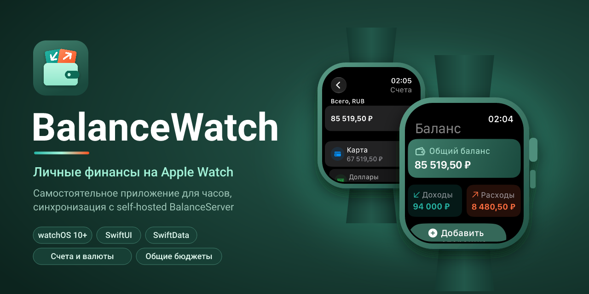

<p align="center">
  
</p>

# BalanceWatch

Самостоятельное (watch-only) приложение Balance для watchOS 10+, выделенное
из монорепозитория Balance (`Balance/BalanceWatch` + общий код).

Стек: SwiftUI + SwiftData, синхронизация через self-hosted BalanceServer.

## Структура

```text
BalanceWatch/
├── branding/             # аватар и баннер для README (PNG + SVG-исходники)
├── docs/CONTRACT_V2.md   # общий контракт экосистемы v2 (копия, одинаковая во всех репозиториях)
├── BalanceWatch.xcodeproj/
└── BalanceWatch/
    ├── App/              # точка входа и экраны часов
    ├── Models/           # SwiftData-модели (копия из монорепы)
    ├── Shared/           # контейнер SwiftData, тема, ServerSync
    ├── Utilities/        # FinanceCalculations, Money (сотые, курсы), форматирование валют
    ├── Views/Components/ # CategoryIconView
    └── Assets.xcassets   # иконка приложения
```

Проект использует папки, синхронизируемые с файловой системой (Xcode 16+):
любой `.swift`-файл, положенный в `BalanceWatch/`, автоматически попадает в
таргет — править `project.pbxproj` вручную не нужно.

## Контракт v2

Часы реализуют клиентскую часть `docs/CONTRACT_V2.md` в компактном виде:

- синхронизируются и хранятся счета, переводы, курсы и настройка
  `baseCurrency`; общий баланс, аналитика и бюджеты считаются в базовой
  валюте, при отсутствии курса показывается «нет курса C→B»;
- экран «Счета» (только чтение) с балансами счетов и «Без счёта»; при
  добавлении операции можно выбрать счёт, валюта следует за счётом;
- общие бюджеты: в «Настройки → Сервер → Бюджет» выбирается личное или общее
  пространство, можно присоединиться по коду; данные каждого пространства
  лежат в отдельном хранилище;
- регулярные операции, цели, долги, вложения и теги хранятся и не теряются
  при пересохранении, но интерфейса для них нет; регулярные операции часы не
  создают;
- если `GET /v1/capabilities` отвечает 404 (сервер v1), счета и общие
  бюджеты скрыты, новые сущности не отправляются.

## Сборка

1. Открыть `BalanceWatch.xcodeproj` в Xcode 16 или новее.
2. Выбрать схему `BalanceWatch` и симулятор Apple Watch.
3. В Signing & Capabilities при необходимости поменять Team и
   bundle id (`com.tolamironcenko.Balance.watchkitapp`).

Из командной строки:

```bash
xcodebuild -project BalanceWatch.xcodeproj -scheme BalanceWatch \
  -destination 'generic/platform=watchOS Simulator' build
```

## CI

GitHub Actions (`.github/workflows/build.yml`) собирает проект на
`macos-15` с последним стабильным Xcode для двух назначений — watchOS
Simulator и watchOS device (без подписи). Запускается на push в
`main`/`develop`, на pull request и вручную (Run workflow). При падении
лог `xcodebuild` прикладывается к запуску как артефакт.

## Важно

Модели, `FinanceCalculations.swift` и `ServerSync.swift` — копии общего
кода из монорепозитория. Протокол синхронизации и правила расчётов должны
совпадать с остальными клиентами Balance: при изменении контракта на
сервере переносите правки и сюда.
